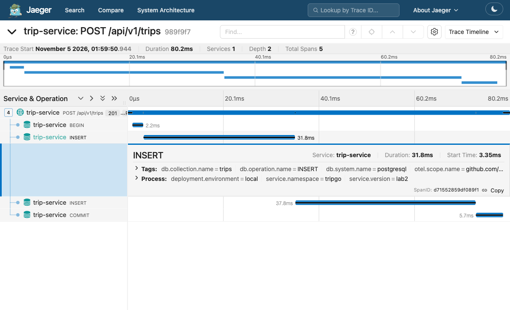
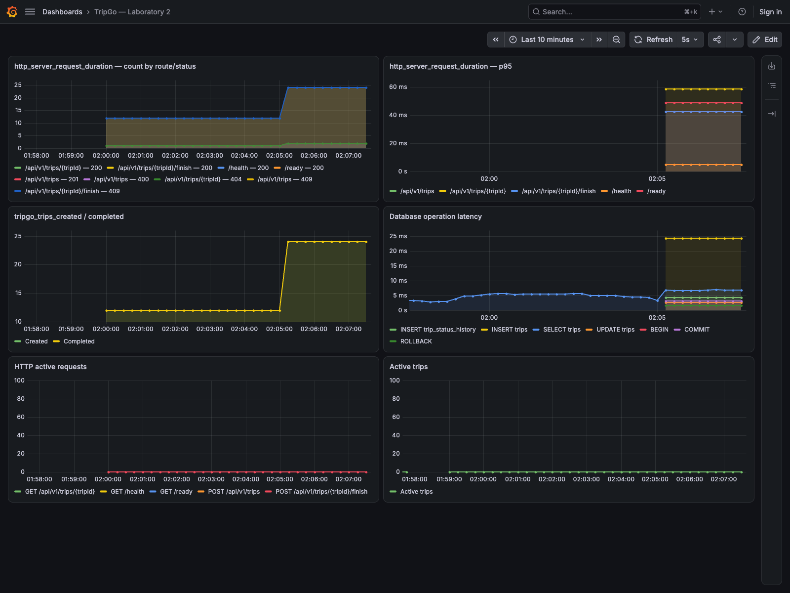

# Проверка лабораторной 2

Первый запуск на окружении курса и скриншоты сделаны 5 ноября 2026 года.
6 ноября проверки были повторены после исправлений. Команды и результаты
повторного запуска находятся в [сверке с условием](lab2-audit.md).
Время в отчёте московское.

Для запуска использовались `tripgoctl`, окружение lab 02, PostgreSQL,
OTel Collector, Jaeger, Prometheus и Grafana.

## Сборка и тесты

Результаты повторной проверки 6 ноября

| Проверка | Результат |
|---|---|
| `make generate` | OpenAPI и gomock генерируются |
| `make lint` | 0 замечаний, все обязательные линтеры включены |
| `make test` | unit-тесты с `-race` проходят |
| Покрытие `domain/trip` | 100% |
| Покрытие `usecase/trip/create`, `get`, `finish` | по 100% |
| `go test -race -count=2 ./...` | повторный запуск unit-тестов проходит |
| `make test-integration` | тесты на PostgreSQL с `-race -tags=integration -count=2` проходят |
| Зависимости домена | нет `net/http`, chi, pgx, squirrel и OTel |
| Контракт и миграции из первой лабораторной | не изменены |

Интеграционные тесты проверяют откат двух таблиц при ошибке второго INSERT,
ошибке после двух INSERT, панике и отмене контекста. Есть отдельные проверки
параллельных создания и завершения поездки, а также вложенного `Do`.

При ошибке commit unit-тест требует вернуть ошибку и не увеличивать
бизнес-счётчик. HTTP-тесты проверяют `invalid_request`, доменные 404/409,
скрытие внутренних деталей, пустое тело finish, health/ready и неверный UUID
через сгенерированный роутер.

В тестах middleware проверяются входящий W3C `traceparent`, имя спана
с шаблоном маршрута, уровни логов и одна запись `request handled`.
Также проверяются атрибуты гистограммы, изменение `active_requests`
и обработка паники.

## HTTP на запущенном сервисе

В первом прогоне отправил 64 запроса. После первого сбора метрик повторил
прогон для графиков.

| Статус | Количество | Сценарий |
|---|---|---|
| 201 | 12 | создание |
| 200 | 26 | получение, завершение, health и ready |
| 409 | 24 | занятый водитель и повторное завершение |
| 404 | 1 | отсутствующая поездка |
| 400 | 1 | невалидное тело |

Результаты сохранены в [http-smoke.json](evidence/http-smoke.json).

## Трейс и логи

У запроса создания в `01:59:50` значение `trace_id`
равно `989f9f77aa4d2e78eaa3b6d3d17f7f13`.

В Jaeger видны пять спанов. Родительский `POST /api/v1/trips` содержит
четыре SQL-спана, `BEGIN`, два `INSERT` и `COMMIT`. У INSERT указаны
`db.operation.name=INSERT` и коллекции `trips` и `trip_status_history`.
В ресурсе записаны `service.name=trip-service`, `service.version=lab2`,
`service.namespace=tripgo` и `deployment.environment=local`.

В [request-logs.jsonl](evidence/request-logs.jsonl) находятся записи
`trip created` и `request handled` с тем же `trace_id` и `span_id`.
[JSON трейса](evidence/create-trip-trace.json) можно загрузить через Upload
в Jaeger, если после перезапуска окружения трейс исчез из памяти.

OTLP gRPC проверил отдельным запуском сервиса. Создал и завершил поездку,
дождался пяти спанов создания в Jaeger и штатно остановил процесс.
Результат сохранён в [grpc-export.json](evidence/grpc-export.json).

## Метрики

На дашборде Grafana видны HTTP-статусы по шаблонам маршрутов, p95,
созданные и завершённые поездки, время SQL-запросов и число активных запросов
и поездок. Метрики поступают через OTel Collector в Prometheus.

[JSON дашборда](../deploy/grafana/trip-service.json) можно импортировать
в другое окружение курса. В `http.route` записываются шаблоны маршрутов,
поэтому каждый UUID не создаёт отдельную серию метрик.

## Работа без коллектора

Для проверки уменьшил число реплик `otel-collector` до нуля и дождался
удаления пода. После этого запустил новый процесс сервиса. Readiness вернул
200, создание вернуло 201, получение и завершение вернули 200. Процесс
остановился с кодом 0. Затем восстановил коллектор до одной реплики.

Результаты сохранены в [collector-unavailable.json](evidence/collector-unavailable.json).

## Исправления и проверки 6 ноября

Тесты покрывают паники до ответа, после `WriteHeader` и после записи части
тела, в том числе через настоящий `httptest.NewServer`. Во всех случаях
клиент получает один `500 Problem`. Частичное тело и заголовки успешного
ответа отбрасываются. В единственном логе запроса есть ошибка и стектрейс.
В спане и гистограмме записан статус 500, `active_requests` возвращается к нулю.

Для валидации добавлены проверки отсутствующих, null и неизвестных полей,
типов UUID, цены и координат, вложенных объектов, синтаксиса JSON и ошибок
чтения тела. В `ValidationError.Cause` сохраняется исходная ошибка,
тесты проверяют её через `errors.Is` и `errors.As`. Отдельно проверяются
ошибки параметров OpenAPI и чтения тела finish-запроса.

Ответы 404 и 405 формируются через общий маппер `Problem`. У 405 сохраняется
`Allow`, а в логах, метриках и имени спана используется шаблон существующего
маршрута. Для неизвестного пути записывается `unmatched`.

## Задание со звёздочкой

Мутационные проверки выполнены 5-6 ноября. Исходные тесты обнаружили
29 из 37 мутаций, после доработки тестов обнаруживаются все 37.
Разбор и исходные результаты находятся в [отчёте по мутациям](mutation/README.md).
